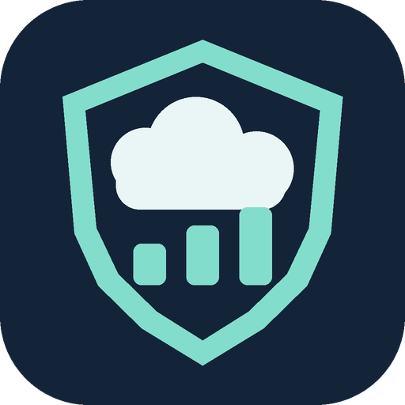

<p align="center"></p>
<h1 align="center">Cloud Quota Guard</h1>
<p align="center">Know your cloud quotas. See what is measured. Act before a limit is exhausted.</p>

[](https://github.com/NirBY/ha-cloud-quota-guard/actions/workflows/validate.yml)
[](https://github.com/NirBY/ha-cloud-quota-guard/releases)
[](https://my.home-assistant.io/redirect/hacs_repository/?owner=NirBY&repository=ha-cloud-quota-guard&category=integration)
[](LICENSE)

Cloud Quota Guard is a **custom Home Assistant integration**, distributed through HACS, with a bundled dashboard card. It monitors verified cloud usage sources, warns at **90%**, and can disable explicitly mapped integrations at **95%**.

**Unknown is never zero.** A service with no verified quota source is clearly labeled as unknown and is not protected. Disabling a Home Assistant integration is not a provider-side spending cap.

English is the default and fallback language. The dashboard follows your Home Assistant profile language, with Hebrew and right-to-left layout supported. Notifications follow the Home Assistant system language. User-defined service names are preserved.

## Features

- Service tiles with utilization, allowance, remaining capacity and measurement freshness.
- Click a tile for provider details, reset period and recorded usage history.
- Graph ranges: one hour, 24 hours, seven days, or all retained observations.
- Focus on small utilization values, or show the full 90%/95% threshold scale.
- Separate **unknown allowance**, **missing/stale measurement**, and **fresh measurement**.
- Search and filters for monitored quotas, services needing attention and unknown limits.
- Inventory of integrations, including local/calculated services and cloud services without a source.
- Persistent notifications, threshold events and administrator-only measurement ingestion.
- Bounded persistent history: up to 3,000 points per metric and 1,000 events.
- Never automatically re-enables an integration after cutoff, including on period reset.

## Installation with HACS

Requires Home Assistant **2026.3 or later**. HACS installation is supported as a **custom repository**; inclusion in the default HACS catalog is a separate review process.

[Open this repository in HACS](https://my.home-assistant.io/redirect/hacs_repository/?owner=NirBY&repository=ha-cloud-quota-guard&category=integration), or:

1. Open **HACS → menu → Custom repositories**.
2. Add `https://github.com/NirBY/ha-cloud-quota-guard` with type **Integration**.
3. Find **Cloud Quota Guard** and download it.
4. Restart Home Assistant.
5. Open **Settings → Devices & services → Add integration → Cloud Quota Guard**.
6. Read the setup description and confirm to start the monitor.

All runtime files, dashboard JavaScript and brand icons are inside `custom_components/quota_guard/`. No separate dashboard repository or external JavaScript CDN is required.

### Manual installation

Copy `custom_components/quota_guard/` from this repository to your Home Assistant `config/custom_components/` directory, restart, and add the integration through Settings.

### Dashboard

The integration registers the bundled JavaScript module automatically. Reload the browser after adding/updating the integration. Add this card to a dashboard:

```yaml
type: custom:quota-guard-card
```

Use `language: en` to keep a card in English, `language: he` for Hebrew, or
`language: auto` (the default) to follow Home Assistant. Other languages fall back
to English. Existing saved events retain their original notification text.

A reusable dashboard template is provided in [examples/dashboard.yaml](examples/dashboard.yaml).
This integration uses a dashboard card rather than an automation blueprint.

For a full-width dashboard, use a Panel view:

```yaml
title: Cloud Quotas
views:
  - title: Quotas
    path: quotas
    type: panel
    cards:
      - type: custom:quota-guard-card
```

If your frontend blocks automatic modules, manually add the resource `/quota_guard/quota-guard-card.js?v=0.4.0` as a JavaScript module. The card is administrator-only because its report includes integration inventory and enforcement details. The integration does not create or overwrite dashboard layouts.

## Supported measurement sources

| Source | What is measured | Requirements / limitations |
| --- | --- | --- |
| GitHub | REST **core** request rate limit | Uses the token of an existing GitHub config entry in memory. Excludes GraphQL, search, HACS and billing allowances. |
| Google Assistant SDK | Project daily conversation request usage | Existing Google Cloud service account, Service Usage and Cloud Monitoring read permissions, supported project association. |
| Google Cloud TTS | Highest reported project request-minute in the provider day | API quota, **not** free/billable voice characters. |
| Google Calendar | Highest reported project request-minute in the provider day | Project quota, not per-user quota. |
| Generic sensor | Your verified current-period usage and limit | A source-provided period identifier and timezone-aware timestamp are required. |
| Administrator report action | Measurements from another trusted adapter | Configure the metric first. No public/unauthenticated webhook is exposed. |

Built-in GitHub/Google measurements are discovered automatically after setup, with enforcement enabled for their mapped integrations. Generic metrics can set `enforce: false` for monitoring only. This release uses fixed 90% warning and 95% cutoff thresholds.

Google quotas are read from the provider's effective limits, rather than assumed free-tier values. Quota limits are cached for one hour. Usage is polled every minute; Google's reporting is delayed and the daily window follows **America/Los_Angeles**. A successful current-day query with no samples displays **0 requests reported**, with a check time and period. This is a reporting observation, not a verified zero-use quota sample: no percentage, remaining balance, cutoff or zero graph point is derived from it. An expired or failed query still raises a loss-of-measurement alert. The adapter does not enable Google APIs or grant permissions for you. Project association currently supports legacy `api-project-N` service accounts whose project number appears in the existing OAuth client ID; unmatched entries are not monitored.

IMOU, OpenAI billing/credits and other unconnected providers are shown as needing a source when discovered. They do **not** have automatic quota protection just because their integration appears in the inventory. Provider email reminders are separate from this integration.

### Provider limit reference cards

The **Provider limits** dashboard filter shows documented limits separately from
measured quotas. These cards are informational: no usage counter, graph, remaining
balance or automatic cutoff is claimed for them.

- **Tuya:** the [Cloud OpenAPI documentation](https://developer.tuya.com/en/docs/iot/frequency-control?id=Kcojz2r2dg1f6)
  specifies different limits for each endpoint and cloud project. The official
  Home Assistant integration uses the Sharing SDK, so these Developer OpenAPI
  examples are clearly marked as reference information, not active account limits.
- **Xiaomi MIoT:** the card shows the entry's configured Auto/Local/Cloud mode.
  [Auto mode](https://github.com/al-one/hass-xiaomi-miot#config) prefers LAN where
  supported and can use cloud access. No unverified daily/account quota is invented
  from polling intervals, device counts or HTTP 429 responses.
- **Telegram Bot:** [published rate guidance](https://core.telegram.org/bots/faq#how-do-i-avoid-hitting-limits)
  distinguishes chats, groups and free bulk broadcasts. [File limits](https://core.telegram.org/bots/api#sending-files)
  distinguish multipart uploads (10 MB photos, 50 MB other files), URL-based sends,
  and standard-server downloads. The 20/minute limit is for groups, not a blanket
  limit for all channels. Custom Bot API endpoints can have different file limits.

Provider policies were checked on 2026-10-31. They are versioned reference data,
not a live feed of each provider's policy or your account's consumption.

## Register a sensor source

In **Developer Tools → Actions**, call `quota_guard.configure`. Replace the example IDs and allowance with real, verified values:

```yaml
action: quota_guard.configure
data:
  id: provider_monthly
  name: Provider monthly free allowance
  entry_ids:
    - REPLACE_WITH_REAL_CONFIG_ENTRY_ID
  kind: free_allowance
  source: https://provider.example/docs/usage
  unit: requests
  usage_entity: sensor.provider_current_month_usage
  limit: 1000  # example only; use your actual allowance
  period_attribute: period
  timestamp_attribute: sampled_at
  max_age: 900
  enforce: true
```

The usage sensor must expose attributes such as:

```yaml
period: "2026-10"
sampled_at: "2026-10-31T10:00:00+00:00"
```

Use `limit_entity` instead of `limit` when a sensor exposes the effective allowance. Do not supply a lifetime total as current-period usage. A config entry ID is different from an entity ID; the dashboard inventory is read from Home Assistant's config entries. Configure one metric for each independent limit. Multiple metrics can share a target integration.

The dashboard's administrator section accepts the same fields as JSON. Configuring an existing metric replaces its configuration.

### Report from another adapter

After configuring a metric without `usage_entity`, a trusted administrator can submit:

```yaml
action: quota_guard.report
data:
  id: provider_monthly
  used: 320
  limit: 1000
  period: "2026-10"
  timestamp: "2026-10-31T10:00:00+00:00"  # replace with a fresh source timestamp
```

Non-finite/negative values, invalid limits, missing periods, stale/future timestamps and out-of-order reports are rejected. Source freshness does not improve just because the dashboard was refreshed.

## Notifications and enforcement

- `quota_guard.configure` and `quota_guard.report` require administrator access.
- Home Assistant persistent notifications identify the affected metric. Missing-data notifications clear when valid measurements return.
- An unchanged missing-data alert is created once, not on every poll. Its latch
  survives restarts and resets on recovery, so forwarding persistent notifications
  to Telegram does not generate a message every minute for the same condition.
- Event `quota_guard_event` carries `id`, `kind`, `threshold`, `detected_at`, `source_at`, `period` and `message`. Route this event to your preferred notification service with an automation; no personal mobile destination is hardcoded.
- At 95% or above, an enforced metric requests persistent disabling of its mapped config entries.
- Cutoff results distinguish `disabled`, `restart_required`, `failed` and `missing`. An unsuccessful unload is not reported as protection.
- Integrations remain disabled until you manually enable them, even after quota reset.
- Missing measurements do not trigger speculative disabling of unrelated integrations.

### Limits of protection

Sampling can miss short bursts. Provider reporting may lag. Usage by other applications in the same account continues after Home Assistant disables an integration. A reported daily peak of minute buckets is not a live minute balance. YAML-only services have no config entry to disable and need a provider-specific stop adapter. Provider API limits are not necessarily billing/free-tier limits. This is best-effort monitoring, not a guarantee against charges.

## Branding and Home Assistant registration

The integration is registered through its manifest/config flow as **Cloud Quota Guard**, with domain `quota_guard`. Original 256px and 512px brand PNGs are bundled under `brand/`; Home Assistant 2026.3+ serves them locally. No separate central brands submission is required for a custom integration.

This project is not a Home Assistant Core integration and does not imply official endorsement. HACS default-catalog submission, if made, remains subject to maintainer review.

## Updating an existing local Quota Guard installation

The domain, storage key, action names, WebSocket command and card type are unchanged. Back up your Home Assistant configuration before replacing the integration. HACS manages the same `custom_components/quota_guard/` folder. Existing `/local/quota-guard/...` card resources can be removed after verifying the bundled card is loaded, to avoid loading an outdated copy. Your existing dashboard layout is preserved.

## Troubleshooting

- **Custom element not found:** verify that the integration is loaded, then reload the browser. The bundled resource path is shown above.
- **Unknown command:** the integration is not yet loaded, or you are connecting before startup completed.
- **Allowance known, usage unknown:** check provider permissions, source timestamps and whether the provider has published a current-period sample.
- **Service shown as unknown:** add a verified quota source. A cloud integration may have no applicable quota at all; the inventory does not assert that one exists.
- **No graph:** history begins when verified samples are collected; it is not reconstructed from earlier activity. Gaps and reset boundaries are intentionally disconnected.
- **Google quota missing:** check that Service Usage and Cloud Monitoring are enabled by the project owner and the service account has read permissions.

## Development

```sh
pip install -r requirements-dev.txt
python -m unittest discover -s tests -p 'test_*.py'
node --check custom_components/quota_guard/frontend/quota-guard-card.js
python scripts/validate_package.py
```

The local orchestration tests use a simulated Home Assistant boundary; GitHub Actions additionally runs HACS validation and hassfest. Real providers are never driven to their cutoff for testing. Rebuild original brand assets with `python scripts/build_brand.py`.

[Report an issue](https://github.com/NirBY/ha-cloud-quota-guard/issues) with sanitized logs and version information. Never attach tokens, service-account JSON or Home Assistant `.storage` files.

MIT licensed. See [LICENSE](LICENSE).
