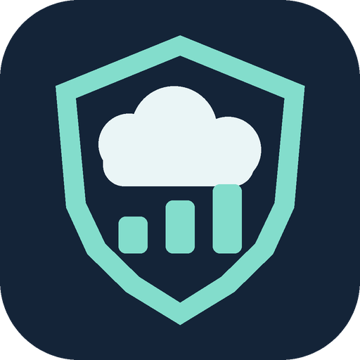
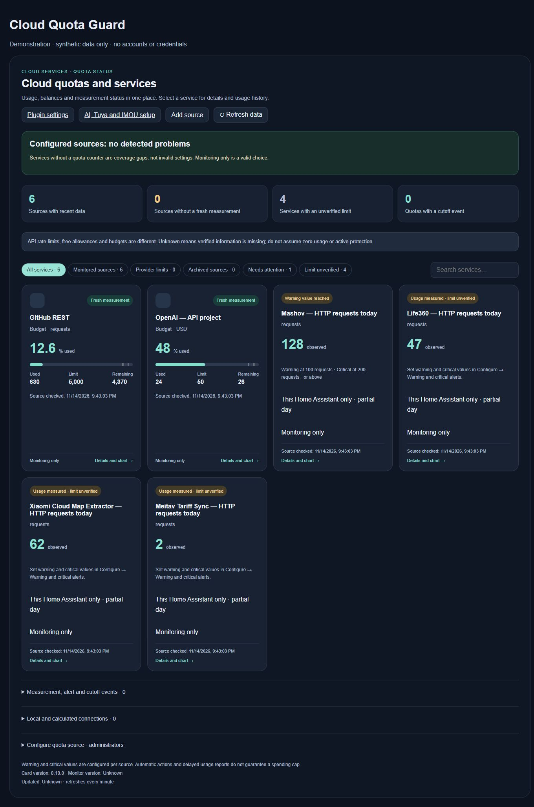
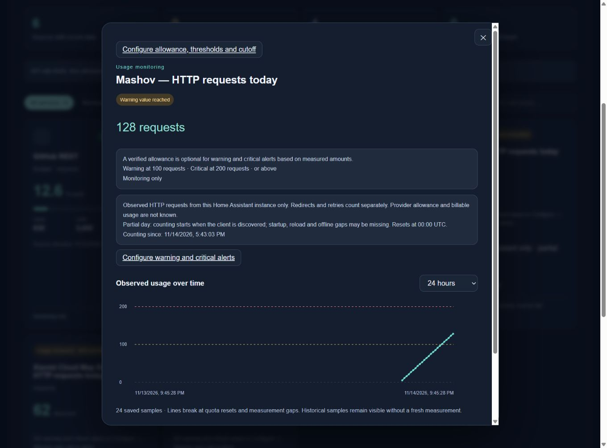

<p align="center"></p>
<h1 align="center">Cloud Quota Guard</h1>
<p align="center">Know your cloud quotas. See what is measured. Act before a limit is exhausted.</p>

[](https://github.com/NirBY/ha-cloud-quota-guard/actions/workflows/validate.yml)
[](https://github.com/NirBY/ha-cloud-quota-guard/releases)
[](https://my.home-assistant.io/redirect/hacs_repository/?owner=NirBY&repository=ha-cloud-quota-guard&category=integration)
[](LICENSE)

Cloud Quota Guard is a **custom Home Assistant integration**, distributed through HACS, with a bundled dashboard card. Configure warning and critical values as **percentages, usage amounts, or low balances**. Alerts work without a verified allowance. Optional cutoff disables selected Home Assistant integrations, powers off selected Oracle instances, or applies supported provider controls. All automatic actions default to **off**.

**Unknown is never zero.** Discovery is not a usage measurement. Supported request counters appear automatically; unrelated cloud integrations do not appear as broken quota monitors. Disabling a Home Assistant integration is not a provider-side spending cap.

English is the dashboard's default and fallback language, including when Home Assistant uses Hebrew. Set `language: he` for Hebrew/right-to-left, or explicitly choose `language: auto` to follow your profile. Native Home Assistant forms follow the profile language. Source entity names default to English; user-defined names are preserved. Notifications follow the Home Assistant system language.

## Setup help

New in 0.10: [automatic request counters](#automatic-request-counters),
[usage/low-balance alerts and provider cutoff](docs/usage-and-controls.md),
and an [English view installer](#english-dashboard-view).

The **? / Help** button in Home Assistant opens this README. Choose the form you
are filling in: [GitHub](#setup-help-github), [Google](#setup-help-google),
[AI services](#setup-help-ai), [Tuya / IMOU](#setup-help-tuya),
[existing sensor](#setup-help-sensor), or [automatic counters](#automatic-request-counters).

Open **Settings → Devices & services → Cloud Quota Guard → Configure**. **Connection
name** is a label you choose, such as `Personal GitHub` or `Home Google project`;
it is not a username or password. Enter credentials directly in Home Assistant.
Do not put tokens or private keys in GitHub issues, chat messages or screenshots.

### Setup help AI

Choose **Configure → AI services**, then a provider and API/team or personal account
path. The [credential and usage table](docs/usage-and-controls.md#ai-services-personal-subscriptions-tuya-and-imou)
explains exactly which key and account each form supports. Personal subscription
limits may require an existing sensor or a manual reading.

<a id="setup-help-openai"></a><a id="setup-help-google_ai"></a><a id="setup-help-claude"></a><a id="setup-help-cursor"></a><a id="setup-help-deepseek"></a><a id="setup-help-grok"></a><a id="setup-help-meta_ai"></a><a id="setup-help-openrouter"></a><a id="setup-help-mistral"></a>

For all AI forms, enter a descriptive **connection name** and the credentials in
their separate fields. Read [the provider-specific setup table](docs/usage-and-controls.md#ai-services-personal-subscriptions-tuya-and-imou)
before choosing an API key. Credentials remain in Quota Guard's own config entry.

### Setup help Tuya

### Setup help IMOU

Open **Configure → Tuya usage** or **IMOU usage**. Connect an existing sensor, enter
an actual console reading, or update a saved reading. These forms do not borrow
another integration's credentials or invent a provider counter. See
[usage sources and IMOU exhaustion](docs/usage-and-controls.md#ai-services-personal-subscriptions-tuya-and-imou).

### Setup help manual

Enter the value, unit, real reporting period and timezone-aware timestamp of the
reading. A remaining balance can only be converted into used allowance when that
allowance is known. Personal app readings must be updated manually; saving a form
does not create an automatic account API.

## Automatic request counters

Supported Mashov, Life360, Xiaomi Cloud Map Extractor and Meitav clients are
discovered automatically on first install and when added later. No extra API key
is needed. Counters measure this Home Assistant instance's observed HTTP requests,
including retries and redirects, and are labelled as partial UTC days. They do
not reveal provider allowances or billable usage. Other integrations need a
supported owned-session interface or an existing usage sensor.

See [supported versions, gaps, persistence and the author interface](docs/usage-and-controls.md#automatic-request-counters).
Use **Configure → Warning and critical alerts** to set amounts such as 100 / 200
requests without a known quota. Automatic cutoff remains off until configured.

## English dashboard view

Choose **Configure → Add English dashboard view**, then an existing editable
dashboard. The action appends the Cloud Quotas view once and preserves existing views.
Create an editable dashboard first if you only have an automatically generated one.

For installation through an automation, import
[the Add English view blueprint](blueprints/automation/quota_guard/add_english_view.yaml),
select the dashboard URL path and run the automation's actions once. It also runs
at Home Assistant startup; repeated runs do not duplicate the view. This is an
automation blueprint that installs a Lovelace view, not a Lovelace blueprint type.
The direct admin action is `quota_guard.add_dashboard_view` with `dashboard_path`.

The following screenshots use **synthetic demonstration data only**, with no
personal accounts, device identifiers, credentials or family information.





Reproduce the demo by serving the repository locally and opening
[examples/demo.html](examples/demo.html). It uses the actual bundled card.

### Setup help GitHub

This connection reads the authenticated account's **REST core API quota**. It does
not measure GitHub billing, GraphQL or every individual app's allowance.

1. Sign in to the GitHub account whose quota you want to monitor. Open **Settings
   → Developer settings → Personal access tokens → Fine-grained tokens → Generate
   new token**. Choose a descriptive name and expiration. Keep permissions minimal:
   the rate-limit endpoint requires no additional permissions, including private
   repository access. See [GitHub's token instructions](https://docs.github.com/en/authentication/keeping-your-account-and-data-secure/managing-your-personal-access-tokens)
   and [rate-limit endpoint permissions](https://docs.github.com/en/rest/rate-limit/rate-limit).
2. In Quota Guard, choose **Connect GitHub** and fill in:

   | Field | What to enter |
   | --- | --- |
   | Connection name | A label, for example `Personal GitHub`. |
   | GitHub token | The complete token value you generated, without quotes or a `Bearer ` prefix. This is not your GitHub password. |

3. Click **Submit**. The token is checked with GitHub before it is saved. An invalid
   token leaves the form open with an error.
4. The integration page shows a **GitHub — your label** service device and a
   **Connection** sensor. It starts as **Pending first check**, then becomes
   **Connected** after polling succeeds. Within a minute, its usage entity and
   dashboard tile show usage, allowance, remaining calls and reset information.

If an older GitHub source still says it needs reconnection, first verify that the
new source measures the intended account. Then open the old source and select
**Mark this old source as handled**. Its history is retained separately.

### Setup help Google

Use a **Google Cloud service-account JSON key** for the project being measured.
An OAuth client-secret file, API key, Google password or just the private-key
string will not work. The JSON's `project_id` selects the project; add a separate
connection if your APIs use different projects.

1. In [Google Cloud Console](https://console.cloud.google.com/), select the project
   used by your Home Assistant API integrations. Enable **Service Usage API** and
   **Cloud Monitoring API** under **APIs & Services → Library**. Select only APIs
   that are actually used and enabled in that project.
2. Under **IAM & Admin → Service Accounts**, create or select a service account
   for Quota Guard. It needs `serviceusage.quotas.get` and
   `monitoring.timeSeries.list` on that project. Google's read-only **Service Usage
   Viewer** role (`roles/serviceusage.serviceUsageViewer`) includes both; a custom
   role containing these permissions is also suitable. Owner/Editor is not needed.
   See [Google's role permissions](https://docs.cloud.google.com/iam/docs/roles-permissions/serviceusage#serviceusage.serviceUsageViewer).
3. Open that account's **Keys → Add key → Create new key → JSON** and keep the
   downloaded file private. If your organization blocks JSON keys, consult your
   administrator instead of weakening its policy. See [Google's key instructions](https://docs.cloud.google.com/iam/docs/keys-create-delete).
4. In Quota Guard choose **Connect Google project** and fill in:

   | Field | What to enter |
   | --- | --- |
   | Connection name | A label, for example `Home Google project`. |
   | Service-account JSON key | The complete JSON object from the downloaded file, on one line. Preserve the escaped `\n` inside `private_key`; do not paste a file path. |
   | Project APIs | Select **Google Assistant SDK**, **Google Cloud Text-to-Speech**, and/or **Google Calendar**, only for the APIs used in this project. |

   On Windows, this local PowerShell command copies compact JSON to your clipboard
   without uploading it or printing the key. Replace the file path with yours:

   ```powershell
   Get-Content -LiteralPath '.\quota-guard-key.json' -Raw |
     ConvertFrom-Json | ConvertTo-Json -Depth 20 -Compress | Set-Clipboard
   ```

5. Click **Submit**. JSON/key validation happens immediately; permission and API
   access checks happen on the first poll. Open the new **Google — your label**
   device to see connection status and one usage entity per selected API.

| Selected API | Measurement |
| --- | --- |
| Google Assistant SDK | Reported conversation requests in the provider day. |
| Google Cloud Text-to-Speech | Highest reported request-minute today, not free voice characters. |
| Google Calendar | Highest reported project request-minute today, not a per-user allowance. |

A successful check with no usage samples keeps the connection **Connected** but
leaves the usage entity unavailable; the dashboard explains the delayed report.
It does not invent a zero-use measurement. A 403 error usually requires checking
the project, enabled APIs and read permissions. Follow the error shown in details.

### Setup help Oracle

Choose **Configure → Connect Oracle Cloud API**. This connects directly to OCI
using credentials entered into Quota Guard. It works independently of an external
scanner or Home Assistant usage sensor. Oracle uses an **API signing key**, not an
OCI auth token, console password or compute-instance SSH key.

1. In OCI, open your user's **API keys** and create or select a signing key. Keep
   the private PEM key locally. See [Oracle's signing-key instructions](https://docs.oracle.com/en-us/iaas/Content/API/Concepts/apisigningkey.htm).
2. Grant the key's user the permissions needed to read reported usage:
   `Allow group <your-group> to read usage-report in tenancy`.
   See [Oracle Cost Analysis permissions](https://docs.oracle.com/en-us/iaas/Content/Billing/Concepts/costanalysisoverview.htm).
3. Enter a **Connection name**, **Tenancy OCID**, **User OCID**, **API key
   fingerprint**, **OCI home region** (for example `il-jerusalem-1`), and the
   complete **API signing private key (PEM)**. Enter its passphrase only if encrypted.
   Multiline PEM, flattened PEM and escaped newlines are accepted. The key is
   checked against the fingerprint locally before Oracle is contacted. No OCI
   profile, key file, instance principal or other integration's credentials are read.
4. Select the returned **Usage meters**. Each service/SKU/unit combination remains
   separate. The selected meters appear under the Oracle service and dashboard.
   Use **Choose Oracle usage meters** later to add or archive selections.
5. For each meter, choose **Configure thresholds and cutoff**, then enter the
   **verified monthly allowance** applicable to your account and the meter's exact
   unit. Leave it blank for usage-only monitoring. The Usage API does not identify
   every free-tier entitlement; the plugin does not invent a universal free limit.

This supports reported monthly usage meters across OCI services and commercial
regions; it is not tied to one application or tenancy. Only meters returned by the
Usage API can be selected. Resource counts, real-time utilization and allowances
absent from that API are not inferred. Usage is queried every 15 minutes using the
UTC calendar month. A new/quiet account may have no selectable meters until Oracle
publishes usage. Missing or failed reports do not become zero-use measurements.

#### Oracle power-off and configurable percentages

**Warning percentage** and **Power-off percentage** are configurable per meter.
The defaults are 90 and 95; choose any `0 < warning < cutoff <= 100`. The same
percentages drive notifications, charts and the automatic-action decision.

To enable Oracle power-off, enter the exact **Compute instance OCIDs** in the
connection's region, press Enter after each, enable power-off and confirm that
those instances consume the selected quota. Quota Guard checks each instance
before saving. The credential needs permission to read each selected instance
and perform `INSTANCE_POWER_ACTION`. Restrict IAM access to the intended
compartment/instances; see [Oracle's Compute policy reference](https://docs.oracle.com/en-us/iaas/Content/Identity/Reference/corepolicyreference.htm).

Saving an enabled rule can act immediately if the current reported usage is
already above the threshold. The only cloud mutation is `SOFTSTOP` on those
selected running instances. It requests graceful shutdown; OCI powers off after
15 minutes if shutdown has not completed. The integration never starts, restarts
or terminates resources. See [Oracle instance power actions](https://docs.oracle.com/en-us/iaas/tools/python/latest/api/core/client/oci.core.ComputeClient.html#oci.core.ComputeClient.instance_action).

Oracle usage reports are delayed, so this is not a guaranteed spending cap.
Stopping compute does not stop storage or other resource charges. Select a
threshold that leaves headroom for reporting delay. Stale/unknown measurements,
missing allowances and unconfirmed targets cannot trigger Oracle power-off.
Other providers can disable selected Home Assistant integrations or use a
[supported provider control](docs/usage-and-controls.md#provider-cutoff).
Each screen identifies the action and requires explicit opt-in.

### Setup help sensor

Choose **Add sensor source**, or **Add source** on the quota dashboard. Select an
existing usage sensor, its unit and an optional verified allowance. Set the actual
source timestamp and reporting period. A web page URL alone is not a data source.

For an external Oracle Free Tier estimate, select the usage sensor published by
your own monitor. Use `%` and a fixed allowance of `100` only if that sensor already
reports a percentage. Configure its actual timestamp attribute, reporting period,
reset timezone and update interval. Name it **Oracle Free Tier — external usage
estimate**. Any compatible sensor is supported; a monitor/application name is not
required. Use **Connect Oracle Cloud API** for direct API monitoring and power-off.

### After saving

Saved providers are visible under the existing Quota Guard integration entry;
they do not create a second installation of the integration. Click its device or
entity count to inspect the connections. The quota dashboard remains the place
for charts, thresholds and archived sources. Monitoring is enabled by saving;
automatic cutoff requires a separate explicit configuration.

## Features

- Service tiles with utilization, allowance, remaining capacity and measurement freshness.
- Usage-only measurements and raw-unit charts when the limit is unknown.
- Optional GitHub/Google connections with credentials supplied directly to Quota Guard.
- Links to mapped cutoff integrations and directly related automations.
- Click a tile for provider details, reset period and recorded usage history.
- Graph ranges: one hour, 24 hours, seven days, or all retained observations.
- Focus on small utilization values, or show the full scale with your configured thresholds.
- Separate **unknown allowance**, **missing/stale measurement**, and **fresh measurement**.
- Search and filters for monitored quotas, services needing attention and unknown limits.
- Inventory of integrations, including local/calculated services and cloud services without a source.
- Persistent notifications, threshold events and administrator-only measurement ingestion.
- Bounded persistent history: up to 3,000 points per metric and 1,000 events.
- Never automatically re-enables an integration after cutoff, including on period reset.

## Installation with HACS

Requires Home Assistant **2026.3 or later**. HACS installation is supported as a **custom repository**; inclusion in the default HACS catalog is a separate review process.

[Open this repository in HACS](https://my.home-assistant.io/redirect/hacs_repository/?owner=NirBY&repository=ha-cloud-quota-guard&category=integration), or:

1. Open **HACS → menu → Custom repositories**.
2. Add `https://github.com/NirBY/ha-cloud-quota-guard` with type **Integration**.
3. Find **Cloud Quota Guard** and download it.
4. Restart Home Assistant.
5. Open **Settings → Devices & services → Add integration → Cloud Quota Guard**.
6. Read the setup description and confirm to start the monitor.

All runtime files, dashboard JavaScript and brand icons are inside `custom_components/quota_guard/`. No separate dashboard repository or external JavaScript CDN is required.

### Reliable upgrades

HACS replaces the managed `custom_components/quota_guard/` directory during an
update. All runtime code, frontend assets, translations and icons are committed
inside that directory. Local edits there must be published in a release to survive
an update. Quota configuration/history remain in `.storage/quota_guard`; dashboard
configuration remains in Home Assistant's Lovelace storage.

The release archive is built with `python scripts/package_release.py`. Validation
checks every runtime file and simulates replacing an old component while retaining
stored settings/history. Frontend URLs are content-addressed, and a newer module
updates an already registered card instead of silently keeping the old class.
An older module cannot downgrade the active card. The footer's versions help
identify a browser left open on older code.

### Manual installation

Copy `custom_components/quota_guard/` from this repository to your Home Assistant `config/custom_components/` directory, restart, and add the integration through Settings.

### Dashboard

The integration registers the complete bundled JavaScript module automatically using a URL derived from its content. Restart Home Assistant after a HACS update. Already open cards can update their registered implementation when the new module loads; future updates are also detected by the card report. Reload the browser once when upgrading from versions before 0.5.1. The card footer shows both card and monitor versions. Add this card to a dashboard:

```yaml
type: custom:quota-guard-card
```

Use `language: en` (the default) to keep a card in English, `language: he` for Hebrew, or
`language: auto` to follow Home Assistant. Other languages fall back
to English. Existing saved events retain their original notification text.

A reusable dashboard template is provided in [examples/dashboard.yaml](examples/dashboard.yaml).
This integration uses a dashboard card rather than an automation blueprint.

For a full-width dashboard, use a Panel view:

```yaml
title: Cloud Quotas
views:
  - title: Quotas
    path: quotas
    type: panel
    cards:
      - type: custom:quota-guard-card
```

If your frontend blocks automatic modules, manually add the resource `/quota_guard/quota-guard-card.js?v=0.5.1` as a JavaScript module. The card is administrator-only because its report includes integration inventory and enforcement details. The integration does not create or overwrite dashboard layouts.

## Supported measurement sources

| Source | What is measured | Requirements / limitations |
| --- | --- | --- |
| GitHub | REST **core** request rate limit | User-supplied Quota Guard token; no other integration’s credentials are read. Excludes GraphQL, search, HACS and billing allowances. |
| Google Assistant SDK | Project daily conversation request usage | User-supplied Quota Guard service account, Service Usage and Cloud Monitoring read permissions, explicit API selection. |
| Google Cloud TTS | Highest reported project request-minute in the provider day | API quota, **not** free/billable voice characters. |
| Google Calendar | Highest reported project request-minute in the provider day | Project quota, not per-user quota. |
| Oracle Cloud | Reported monthly usage by selected service/SKU/unit | Own OCI API signing key, read usage-report access and user-verified allowance. Optional explicitly selected compute power-off. |
| Tuya | Reference policy only; no built-in measurement | Connect a verified sensor or administrator report if available. Quota Guard does not patch the Tuya SDK. |
| Generic sensor | Your verified current-period usage and limit | A source-provided period identifier and timezone-aware timestamp are required. |
| Administrator report action | Measurements from another trusted adapter | Configure the metric first. No public/unauthenticated webhook is exposed. |

All sources default to monitor-only (`enforce: false`). GitHub, Google and Oracle API connections are opt-in. Only an explicit administrator configuration can authorize cutoff for selected targets. Warning and cutoff percentages are configurable for every source; the defaults are 90% and 95%.

Google quotas are read from the provider's effective limits, rather than assumed free-tier values. Quota limits are cached for one hour. Usage is polled every minute; Google's reporting is delayed and the daily window follows **America/Los_Angeles**. A successful current-day query with no samples displays **0 requests reported**, with a check time and period. This is a reporting observation, not a verified zero-use quota sample: no percentage, remaining balance, cutoff or zero graph point is derived from it. An expired or failed query still raises a loss-of-measurement alert. The adapter does not enable Google APIs or grant permissions for you. The project comes from the service account supplied to Quota Guard. Select the APIs to monitor explicitly; no OAuth/config-entry matching is performed.

Google Translate TTS uses an unofficial speech service, separate from Google Cloud TTS. An unavailable quota source does not mean its integration is disconnected.

IMOU, OpenAI billing/credits and other unconnected providers are shown as needing a source when discovered. They do **not** have automatic quota protection just because their integration appears in the inventory. Provider email reminders are separate from this integration.

### Connect GitHub or Google explicitly

Open **Configure → Connect GitHub** or **Connect Google project**. These credentials
are stored only in Quota Guard's own Home Assistant config entry. They are not
included in the dashboard report, metric storage or events. No credentials are
imported from another integration. Restart is not required; polling starts within
one minute. **Remove provider connection** removes credentials and stops polling;
remove and add a connection to replace its credentials.

See the field-by-field [GitHub setup guide](#setup-help-github) and
[Google setup guide](#setup-help-google) for credentials, read permissions,
examples and what to expect after saving.

Use **Configure → Configure thresholds and cutoff** to select a measured quota,
choose its warning/cutoff percentages, explicitly map targets, and opt in. This screen calls the
same administrator configuration handler as `quota_guard.configure`. Automatic
polls cannot add targets or turn cutoff on. A monitoring connection never implies
permission to disable another integration.

### Upgrade from 0.6.x or earlier

Legacy automatic GitHub/Google/Tuya metrics move to `retired_metrics` in the existing
`.storage/quota_guard` data, retaining their history but stopping evaluation.
New GitHub/Google connections require credentials supplied through Quota Guard's
own Configure screen. All pre-upgrade cutoff settings are reset to monitor-only,
including old manual configurations whose defaults did not establish explicit
consent. Re-select targets and enable cutoff if desired. Sensor sources, their
history and saved events remain intact. Already disabled integrations are never
automatically re-enabled. Home Assistant displays a one-time migration notice.

### IMOU monthly calls

An active `imou_life` monthly quota repair or an `OP1013` setup failure marks the affected account as exhausted, even when no repair is available.
Quota Guard sends at most one closing notification per account and quota month with the expected reset date and
pauses further alerts for that outage, including after a restart. The dashboard
continues showing the incident and its reset date. IMOU publishes a first-of-month
renewal schedule. The exact hour and timezone are unspecified. Clearing the repair
on a loaded integration ends the incident. This signal cannot give an advance
usage warning. [IMOU renewal schedule](https://open.imoulife.com/price)

`OP1013` is a provider-side exhausted allowance. Quota Guard reports it; it cannot
restore allowance or make cloud calls succeed. Recovery requires quota renewal
or additional allowance from IMOU. Alert suppression does not stop IMOU setup
retries or change its polling settings.

### Diagnose configuration and source problems

The dashboard's **Action required** section remains visible regardless of the
selected tile filter. Each problem shows its cause, the affected field or entity,
and a recommended fix. Open details to see timestamp age, allowed age, provider
HTTP status or a missing cutoff target. **Plugin settings** opens the native
configuration screen, and sensor details offer **Edit source**.

The diagnostics distinguish an invalid configuration, an unavailable source,
provider authentication/permissions/rate-limit errors, and integration setup
failures. A connected service without a quota counter is a coverage gap, not an
invalid configuration. Monitoring without an allowance or automatic cutoff is
valid. Never interpret a missing measurement as zero usage.

Old automatic sources retired during the 0.7 upgrade now remain visible with
their reconnection instructions and saved history. After reconnecting or deciding
not to replace an old source, **Mark this old source as handled** clears only its
attention item. The source stays in **Archived sources**; no history is deleted,
no integration is enabled or disabled, and active source errors cannot be hidden
this way. The underlying `quota_guard.acknowledge_retired` action is admin-only.

### Add a sensor source without JSON

Open **Settings → Devices & services → Cloud Quota Guard → Configure → Add sensor
source**, or click **Add source** on the bundled dashboard. Existing sensor
sources can be edited through **Configure → Edit source**, or from their dashboard
details. Both screens support English and Hebrew.

Choose a name, stable source ID, usage sensor and unit. An optional usage-page URL
links to the original dashboard; its contents are not fetched. Add a fixed
allowance or an allowance sensor when available. Without a verified allowance,
the source displays usage without a percentage. Configure absolute warning and
critical amounts through **Configure alerts**; cutoff requires separate opt-in.

The usage sensor must supply a period and a timezone-aware measurement timestamp,
normally through `period` and `sampled_at` attributes. You can select different
attribute names, separate period/timestamp sensors, and a numeric usage attribute.
The screen does not substitute the current time for a missing provider timestamp.

For monthly counters without a period attribute, explicitly choose **Calendar
month** and the provider's reset timezone. The period is derived from the source
timestamp. A previous month's sample is not reused after the month changes.

Automatic cutoff is **off by default** in these screens. Monitoring an external
service does not require a Home Assistant integration mapping. Enabling cutoff
requires explicitly selected target integrations and only acts on fresh numeric
measurements. Existing provider-side shutdown controls remain independent.

For an external Oracle Free Tier source, choose your own verified sensor and its
actual unit, allowance, timestamp and period. Keep estimates labeled as estimates.
See the [generic sensor example](examples/oracle-free-tier.yaml), or use
[direct Oracle API setup](#setup-help-oracle) to configure API usage and compute
power-off without relying on an external monitor.

### Usage when the limit is unknown

Omit `limit` and `limit_entity` to monitor verified sensor usage without a quota
limit. The `quota_guard.report` action also accepts a report without `limit`.
A source timestamp and provider period are still required. Raw usage and its
history are shown; no percentage, remaining balance or quota cutoff is inferred.
If a fixed verified limit was configured, reports without a limit use that value.

The former Tuya SDK observer has been removed. Quota Guard never wraps another
integration’s HTTP client. Tuya remains in the inventory with reference policies;
connect a verified sensor or report source to measure usage.

### Cutoff targets and automation dependencies

Metric details link the mapped integrations and automations with explicit entity
or device references to them. Integration cutoff leaves those automations enabled;
they may lose a service or data source. This is not an exhaustive dependency graph:
templates, areas, scripts and indirect service calls may introduce other dependencies.

### Provider limit reference cards

The **Provider limits** dashboard filter shows documented limits separately from
measured quotas. These cards are informational: no usage counter, graph, remaining
balance or automatic cutoff is claimed for them.

- **Tuya:** the [Cloud OpenAPI documentation](https://developer.tuya.com/en/docs/iot/frequency-control?id=Kcojz2r2dg1f6)
  specifies different limits for each endpoint and cloud project. The official
  Home Assistant integration uses the Sharing SDK, so these Developer OpenAPI
  examples are clearly marked as reference information, not active account limits.
- **Xiaomi MIoT:** the card shows the entry's configured Auto/Local/Cloud mode.
  [Auto mode](https://github.com/al-one/hass-xiaomi-miot#config) prefers LAN where
  supported and can use cloud access. No unverified daily/account quota is invented
  from polling intervals, device counts or HTTP 429 responses.
- **Telegram Bot:** [published rate guidance](https://core.telegram.org/bots/faq#how-do-i-avoid-hitting-limits)
  distinguishes chats, groups and free bulk broadcasts. [File limits](https://core.telegram.org/bots/api#sending-files)
  distinguish multipart uploads (10 MB photos, 50 MB other files), URL-based sends,
  and standard-server downloads. The 20/minute limit is for groups, not a blanket
  limit for all channels. Custom Bot API endpoints can have different file limits.

Provider policies were checked on 2026-10-31. They are versioned reference data,
not a live feed of each provider's policy or your account's consumption.

## Register a sensor source

In **Developer Tools → Actions**, call `quota_guard.configure`. Replace the example IDs and allowance with real, verified values:

```yaml
action: quota_guard.configure
data:
  id: provider_monthly
  name: Provider monthly free allowance
  entry_ids:
    - REPLACE_WITH_REAL_CONFIG_ENTRY_ID
  kind: free_allowance
  source: https://provider.example/docs/usage
  unit: requests
  usage_entity: sensor.provider_current_month_usage
  limit: 1000  # example only; use your actual allowance
  period_attribute: period
  timestamp_attribute: sampled_at
  max_age: 900
  enforce: true
```

The usage sensor must expose attributes such as:

```yaml
period: "2026-10"
sampled_at: "2026-10-31T10:00:00+00:00"
```

Use `limit_entity` instead of `limit` when a sensor exposes the effective allowance. Do not supply a lifetime total as current-period usage. A config entry ID is different from an entity ID; the dashboard inventory is read from Home Assistant's config entries. Configure one metric for each independent limit. Multiple metrics can share a target integration.

The dashboard’s administrator section accepts the same fields as JSON. Configuring an existing manual metric replaces its configuration. Provider measurement fields cannot be overwritten; only cutoff mappings can be changed. Omitting `enforce` leaves cutoff off.

### Report from another adapter

After configuring a metric without `usage_entity`, a trusted administrator can submit:

```yaml
action: quota_guard.report
data:
  id: provider_monthly
  used: 320
  limit: 1000
  period: "2026-10"
  timestamp: "2026-10-31T10:00:00+00:00"  # replace with a fresh source timestamp
```

Non-finite/negative values, invalid limits, missing periods, stale/future timestamps and out-of-order reports are rejected. Source freshness does not improve just because the dashboard was refreshed.

## Notifications and enforcement

- `quota_guard.configure` and `quota_guard.report` require administrator access.
- Home Assistant persistent notifications identify the affected metric. Missing-data notifications clear when valid measurements return.
- An unchanged missing-data alert is created once, not on every poll. Its latch
  survives restarts and resets on recovery, so forwarding persistent notifications
  to Telegram does not generate a message every minute for the same condition.
- Event `quota_guard_event` carries `id`, `kind`, `threshold`, `detected_at`, `source_at`, `period` and `message`. Route this event to your preferred notification service with an automation; no personal mobile destination is hardcoded.
- At the configured critical threshold, an explicitly enabled control disables mapped Home Assistant integrations or applies a supported provider action. Oracle SOFTSTOP requires a known allowance and explicitly selected compute instances.
- Cutoff results distinguish `disabled`, `restart_required`, `failed` and `missing`. An unsuccessful unload is not reported as protection.
- Integrations remain disabled until you manually enable them, even after quota reset.
- Missing measurements do not trigger speculative disabling of unrelated integrations.

### Limits of protection

Sampling can miss short bursts. Provider reporting may lag. Usage by other applications in the same account continues after Home Assistant disables an integration. A reported daily peak of minute buckets is not a live minute balance. YAML-only services have no config entry to disable and need a provider-specific stop adapter. Provider API limits are not necessarily billing/free-tier limits. This is best-effort monitoring, not a guarantee against charges.

## Branding and Home Assistant registration

The integration is registered through its manifest/config flow as **Cloud Quota Guard**, with domain `quota_guard`. Original 256px and 512px brand PNGs are bundled under `brand/`; Home Assistant 2026.3+ serves them locally. No separate central brands submission is required for a custom integration.

This project is not a Home Assistant Core integration and does not imply official endorsement. HACS default-catalog submission, if made, remains subject to maintainer review.

## Updating an existing local Quota Guard installation

The domain, storage key, action names, WebSocket command and card type are unchanged. Back up your Home Assistant configuration before replacing the integration. HACS manages the same `custom_components/quota_guard/` folder. Existing `/local/quota-guard/...` card resources can be removed after verifying the bundled card is loaded, to avoid loading an outdated copy. Your existing dashboard layout is preserved.

## Troubleshooting

- **Custom element not found:** verify that the integration is loaded, then reload the browser. The bundled resource path is shown above.
- **Unknown command:** the integration is not yet loaded, or you are connecting before startup completed.
- **Allowance known, usage unknown:** check provider permissions, source timestamps and whether the provider has published a current-period sample.
- **Service shown as unknown:** add a verified quota source. A cloud integration may have no applicable quota at all; the inventory does not assert that one exists.
- **No graph:** history begins when verified samples are collected; it is not reconstructed from earlier activity. Gaps and reset boundaries are intentionally disconnected.
- **Google quota missing:** check that Service Usage and Cloud Monitoring are enabled by the project owner and the service account has read permissions.

## Development

```sh
pip install -r requirements-dev.txt
python -m unittest discover -s tests -p 'test_*.py'
node --check custom_components/quota_guard/frontend/quota-guard-card.js
python scripts/validate_package.py
```

The local orchestration tests use a simulated Home Assistant boundary; GitHub Actions additionally runs HACS validation and hassfest. Real providers are never driven to their cutoff for testing. Rebuild original brand assets with `python scripts/build_brand.py`.

[Report an issue](https://github.com/NirBY/ha-cloud-quota-guard/issues) with sanitized logs and version information. Never attach tokens, service-account JSON or Home Assistant `.storage` files.

MIT licensed. See [LICENSE](LICENSE).
